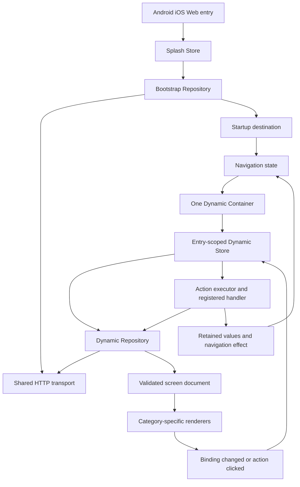

# CB-Partner — Dynamic Runtime V2: Discussion Freeze

> **LATEST REUSABLE TOAST FREEZE (2026-10-26):** [161 — Generic Toast Presentation V1](161-GENERIC-TOAST-PRESENTATION-V1-FREEZE.md). White, no-close top banner, small white check on green, authored white progress track with green 0→100% fill/auto-dismiss; screen-scoped `present` and success-only request trigger reuse existing app/session/renderers. **Source implementation committed but Gradle and Samsung A35 acceptance not yet executed.** Backend read-only. Previous Dialog V1 P5 verification remains historical and does not certify Toast.

> **LATEST OWNER-APPROVED IMPLEMENTATION PLAN (2026-10-26):** [160 — Application-wide Generic Dialog V1](160-APPLICATION-WIDE-GENERIC-DIALOG-V1-IMPLEMENTATION-PLAN.md). Owner-approved exact P0–P5 Frontend scope and source manifest for six reusable Dialog scenarios, one new `IconBadgeElement`, `StackSection` surface properties, app-wide response/error integration, and development-only Splash/Login/OTP previews. **Status: plan frozen, source implementation/testing not yet claimed.** Backend migration is deferred as P6; do not change `CB-Backend/development` during Frontend batch. This supersedes older "next work" suggestions only for the newly approved Dialog work; Login v19/OTP v3 contractual and security constraints remain binding.

> **CURRENT HANDOFF (2026-10-25) — READ THIS FIRST.** The earlier "2026-10-23 / Login v11 / read 140–141 first" notices below are historical. Preserve them as chronology only. The authoritative current checkpoint is **Login v19 + OTP v3 + generic Resend mock success/failure verified on Samsung A35**, with Backend live integration **not yet implemented**. Consult:
>
> 1. [157 — Exact Backend ↔ Frontend Contract Freeze](157-LOGIN-OTP-BACKEND-FRONTEND-EXACT-CONTRACT-RECONCILIATION-FREEZE-2026-10-25.md): already-frozen target APIs, four-field destinations, Backend schema/ScreenComposer gaps, authentication/country blockers; not code implementation.
> 2. [158 — Complete Current Chat / Architecture Handoff](158-2026-10-25-COMPLETE-CHAT-HANDOFF-ARCHITECTURE-RUNTIME-AND-INTEGRATION-GATES.md): authoritative status by evidence, six-category tree, mapper/render/action pipelines, previous Resend verification, pending waves and architectural safeguards.
> 3. [159 — Copy/Paste Next-Chat Prompt](159-NEW-CHAT-STARTER-PROMPT-2026-10-25-BACKEND-INTEGRATION-AND-V2-ARCHITECTURE.md): mandatory full documentation and line-by-line source inspection and productive next implementation scope.
> 4. Latest exact visual fixtures: [Login v19](partner-login-country-picker-parity-v19.json) and [OTP v3](partner-otp-ui-contract-v3.json); matching Web preview fixtures; older JSON is historical only.
>
> **Full-read rule:** Read **ALL** documents and JSON files in this V2 directory in addition to `157–159`; reconcile each historical "frozen/completed/pending" marker with subsequent docs and current source. Inspect the frontend and backend modules, packages, classes and tests line by line. **Current source + latest approved decisions** govern; the index below includes superseded dated text. Minimize repetitive discussion but never skip the correctness gate.

**Current status (2026-10-23):** V2 implementation is in progress. Login v11 dynamic rendering, Country Picker and native offline preview exist; owner accepted removal of fixed error space. Android safe-area ownership, Kotlin common-first migration, product-specific validator policy and remaining screenshot visual parity are OPEN. **Read Documents 140 and 141 first.**
**Historical planning baseline:** Document 20 froze the original V2 plan before later authorized implementation waves. Its "implementation not authorized" and earlier `feature/dynamic-ui` commit `f59577337ac78855da3f9cb474483f0211ed1f30` are historical, not current status.
**Active frontend branch:** `architecture/dynamic-runtime-v2-discussion-freeze`
**Authority:** Current source + latest explicit owner decisions in this V2 folder, with time-ordered supersessions.

## 2026-10-23 latest owner handoff — READ FIRST

**Latest current-source checkpoint before this addendum:** 21229a450e4c001554c70ffbdeef982d1bf415ab on architecture/dynamic-runtime-v2-discussion-freeze. Earlier top-of-file "no implementation authorized" and 2026-10-16 "next logging gate" prose are **historical only**, not the current work queue. Source and latest owner decisions govern present implementation status.

- [140 — Complete 2026-10-23 Conversation Handoff, Common-First Validation & Login Parity](140-2026-10-23-COMPLETE-HANDOFF-COMMON-FIRST-VALIDATION-LOGIN-PARITY.md): **CURRENT status, verified vs pending, full module/six-category/action/validation runtime map, screenshot audit and exact next gates.**
- [141 — Next Chat Starter Prompt](141-NEXT-CHAT-STARTER-PROMPT-COMMON-FIRST-SAFE-AREA-VALIDATION-LOGIN-PARITY-2026-10-23.md): self-contained prompt for full V2 and source reread and efficient continuation.
- [138 — Login v11 Conditional Error](138-LOGIN-V11-CONDITIONAL-ERROR-AND-COMPREHENSIVE-VISUAL-AUDIT-2026-10-23.md): owner-confirmed removal of reserved input-error space; 16dp authored normal gap.
- [139 — Android Safe-Area Host Fix (provisional)](139-ANDROID-NAVIGATION-BAR-SAFE-AREA-HOST-FIX-2026-10-23.md): navigation bar inset code and later compilation dependency fix; subsequent Samsung verification and cross-platform owner migration STILL OPEN.

**Owner latest rule:** commonMain-first Kotlin/Compose Multiplatform Android/iOS/Web; platform-specific only for actual OS APIs, strict SRP/Clean Architecture, no duplication or screen-specific business validation in Dynamic runtime, no overengineering. The latest investigation is whether app/validation/PartnerPhoneNumberValidator and Android-only inset belong where they are; **audit, do not delete/move without backend/source reconciliation and scoped authorization**. Logo/header/hero/terms visual parity remains P0. OTP and P1 cleanup deferred.

## Frozen planning authority
- [20 — PLAN FROZEN V2 Implementation Contract](20-PLAN-FROZEN-V2-IMPLEMENTATION-CONTRACT.md) — authoritative signed-off scope, exact schema, semantics, waves and test gates.
- [19 — Backend Migration Independent Contract](19-BACKEND-MIGRATION-INDEPENDENT-CONTRACT.md) — old and new backend fixture compatibility.
- [17 — Detailed File-by-File Blueprint](17-PASS6-EXACT-IMPLEMENTATION-BLUEPRINT-DRAFT.md) — create/modify/delete manifest as corrected by document 20.
- [18 — Historical Closure Review](18-PASS6-CONTRACT-CLOSURE-AND-FREEZE-REVIEW.md) — earlier proposals, superseded where doc 20 differs.

## Purpose
Record the product owner's completed Hindi-language design discussion in English, before a file-by-file implementation plan. The reference design must be reconciled against source, tests, and older accepted decisions. Conflicts are explicit review items, not silent changes.

## Documents
1. [01-PRINCIPLES-AND-MODULES.md](01-PRINCIPLES-AND-MODULES.md) — rules, modules, DI, KDoc, logging.
2. [02-BOOTSTRAP-NETWORK-AND-CONTRACTS.md](02-BOOTSTRAP-NETWORK-AND-CONTRACTS.md) — bootstrap, HTTP, headers, base URLs, envelopes.
3. [03-DYNAMIC-STRUCTURE-AND-RENDERING.md](03-DYNAMIC-STRUCTURE-AND-RENDERING.md) — six categories, typed mapping/registry/rendering, shell/slots/theme.
4. [04-RUNTIME-BINDINGS-AND-ACTIONS.md](04-RUNTIME-BINDINGS-AND-ACTIONS.md) — MVI, typed values, references, actions, retained state, timers.
5. [05-NAVIGATION-AND-PLATFORM-LIFECYCLE.md](05-NAVIGATION-AND-PLATFORM-LIFECYCLE.md) — destination identity, pop-to/refresh, Android/iOS/Web.
6. [06-TESTING-AND-PLANNING-GATES.md](06-TESTING-AND-PLANNING-GATES.md) — tests, acceptance criteria, unresolved decisions, next phase.

## Illustrative end-to-end path

## Scope and preservation
- Discussion covers all application screens through generic mechanisms, using login/OTP only as illustrative fixtures.
- Supported existing action capabilities to preserve in V2: `request`, `navigate`, `external_uri`, `present`, `dismiss`, `state`, `sequence`. Timers, upload, and new action types remain future extensions. Header/Footer have an agreed additive direction but their exact wire schema remains pending.
- No native login/OTP-specific classes or hardcoded business flows.
- No parallel navigation, network, mapper or cache infrastructure.
- Source/test execution was **not** performed for these documents.
- Treat the source baseline as historical evidence only: Decision 003 changes exist but remain to be verified; earlier frozen decisions retain their existing authority until explicit reconciliation.
- This folder is a **proposal discussion record**, not a second Master State or a replacement for `AI_START_HERE.md`.

## 2026-10-16 current implementation and runtime addendum (read this before older historical statements)

**This section supersedes only this index's earlier pre-implementation status language.** Doc 20 was the historical V2 plan freeze, not a claim that no subsequent implementation occurred. Read the later numbered documents for wave-specific truth; never declare all W1–W8 complete just because initial slices passed.

- Frontend active branch `architecture/dynamic-runtime-v2-discussion-freeze`; last owner-confirmed local fast-forward HEAD `6f67e567`. The owner repaired a corrupted loose `refs/remotes/origin/architecture/dynamic-runtime-v2-discussion-freeze` ref, fetched and fast-forwarded, and `git fsck --full --no-reflogs` completed with only dangling commits reported.
- W1 network, W2 bootstrap, W3 category/slot, W4 navigation and selected action work have later source/verification documents. Relevant most recent action evidence: docs 60–81. The Sequence handler remains an **inert registered placeholder** under later owner decision, superseding the historical executable-Sequence aspiration in plan 20. State implementation is deferred; Present semantics are deferred. Request action and N1 modal-only Dismiss are implemented/verified; resolver consolidation done; obsolete EffectFailed cleanup completed under docs 79–81. Preserve effect batching and independent error ownership. Do not implement deferred features based on older prose.
- Owner-confirmed physical Samsung Android launch on 2026-10-16: Bootstrap then Login screen rendered when APK was built with `-Pcbpartner.api.baseUrl=http://127.0.0.1:3000` and wireless ADB reverse `tcp:3000 tcp:3000`. Web Bootstrap/Login also observed working. Direct phone → Windows LAN IP connection was not resolved; adb reverse is development workaround. The phone's ADB Wi-Fi port changes; always obtain exact device serial from `adb devices -l`. See root README for verified commands.
- Owner-confirmed **Kermit network summary logs** from Android Logcat after local HEAD `6f67e567`: two `I/CBPartnerNetwork` GET successes with statuses 200 and durations 268ms / 58ms. Earlier blank Logcat was due to a stale local APK after corrupted Git fetch. App-only Logcat, not Antigravity Output panel, is presently verified. SLF4J NOP warnings are observed but do not negate Kermit logging.
- **CURRENT DISCUSSION ONLY — NOT APPROVED/FROZEN/IMPLEMENTED:** Improve developer observability with short, visually scan-friendly, correlatable network/request/response/screen navigation/action/state/method-boundary events, showing source→target destination (screenId/templateId/templateType/endpoint), request status/timing, and structured pretty JSON where safely possible. User wants readable color distinctions and asks whether tooling exists for visualization. Colorized Antigravity terminal / viewer capabilities and privacy-safe structured logging are to be researched and source-audited before choosing an implementation. The current frozen safe-logging policy in document 23 prohibits raw bodies, user data, tokens, OTP, device identifiers, arbitrary paths or URL and untrusted server text in **all** environments. No blanket raw JSON log, generic blacklist-only redactor, ANSI escape insertion into Logcat, new logging framework/manager, speculative tooling, or source edits without owner authorization. Proposed pretty JSON must use an explicitly reviewed allowlisted diagnostic projection, or the owner must separately approve a documented policy amendment after risk review.
- **NEXT GATE:** prepare a line-by-line read-only source audit of Kermit setup, `RequestHandler`, `HttpClientBuilder`, `NetworkModule`, app/platform composition, BootstrapRepository/Mapper, SplashStore, DynamicRepository/Mapper, DynamicStore/action executor/handlers and navigation state/effect handoff; inventory the event and destination ownership, existing diagnostics/SLF4J paths, Android/Web output capabilities and available tests. Compare actual code against documents 20, 23, 34, 60–81 and decision logs. Then propose concise sample output, minimal touched-file plan and testing/redaction policy for owner review. Do **not** code until the distinct observability plan is explicitly frozen and implemented separately.

## Latest handoff

- **[140 — 2026-10-23 Complete Current Project Handoff](140-2026-10-23-COMPLETE-HANDOFF-COMMON-FIRST-VALIDATION-LOGIN-PARITY.md)** — current truth, all six UI categories, validation ownership concern, cross-platform inset gate, precise pending UI parity and tests.
- **[141 — Copy/Paste New Chat Prompt](141-NEXT-CHAT-STARTER-PROMPT-COMMON-FIRST-SAFE-AREA-VALIDATION-LOGIN-PARITY-2026-10-23.md)** — mandatory docs and line-by-line source reread; productive next steps.
- [82 — Historical 2026-10-16 Logging Handoff](82-LOGGING-DISCUSSION-AND-NEXT-CHAT-HANDOFF.md) — older evidence; not the current next-work queue.
