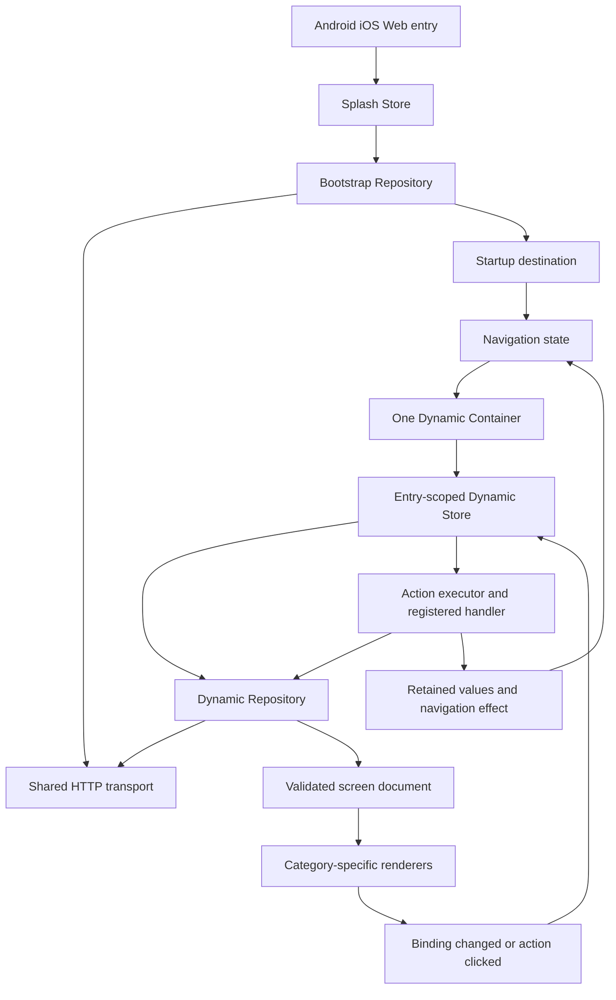

# CB-Partner — Dynamic Runtime V2: Discussion Freeze

**State:** DISCUSSION FROZEN; implementation plan NOT CREATED or authorized.
**Source baseline:** `feature/dynamic-ui` at `f59577337ac78855da3f9cb474483f0211ed1f30`.
**Branch:** `architecture/dynamic-runtime-v2-discussion-freeze`
**Nature:** Greenfield reference architecture. No implementation has been authorized; this does not replace existing accepted/frozen architecture or feature status automatically.

## Purpose
Record the product owner's completed Hindi-language design discussion in English, before a file-by-file implementation plan. The reference design must be reconciled against source, tests, and older accepted decisions. Conflicts are explicit review items, not silent changes.

## Documents
1. [01-PRINCIPLES-AND-MODULES.md](01-PRINCIPLES-AND-MODULES.md) — rules, modules, DI, KDoc, logging.
2. [02-BOOTSTRAP-NETWORK-AND-CONTRACTS.md](02-BOOTSTRAP-NETWORK-AND-CONTRACTS.md) — bootstrap, HTTP, headers, base URLs, envelopes.
3. [03-DYNAMIC-STRUCTURE-AND-RENDERING.md](03-DYNAMIC-STRUCTURE-AND-RENDERING.md) — six categories, typed mapping/registry/rendering, shell/slots/theme.
4. [04-RUNTIME-BINDINGS-AND-ACTIONS.md](04-RUNTIME-BINDINGS-AND-ACTIONS.md) — MVI, typed values, references, actions, retained state, timers.
5. [05-NAVIGATION-AND-PLATFORM-LIFECYCLE.md](05-NAVIGATION-AND-PLATFORM-LIFECYCLE.md) — destination identity, pop-to/refresh, Android/iOS/Web.
6. [06-TESTING-AND-PLANNING-GATES.md](06-TESTING-AND-PLANNING-GATES.md) — tests, acceptance criteria, unresolved decisions, next phase.

## Illustrative end-to-end path

## Scope and preservation
- Discussion covers all application screens through generic mechanisms, using login/OTP only as illustrative fixtures.
- Supported initial actions: `request` and `navigate`. Timer/visibility, richer actions, upload and advanced header/footer behavior are future contract extension points, not authorized implementation.
- No native login/OTP-specific classes or hardcoded business flows.
- No parallel navigation, network, mapper or cache infrastructure.
- Source/test execution was **not** performed for these documents.
- Treat the source baseline as historical evidence only: Decision 003 changes exist but remain to be verified; earlier frozen decisions retain their existing authority until explicit reconciliation.
- This folder is a **proposal discussion record**, not a second Master State or a replacement for `AI_START_HERE.md`.
